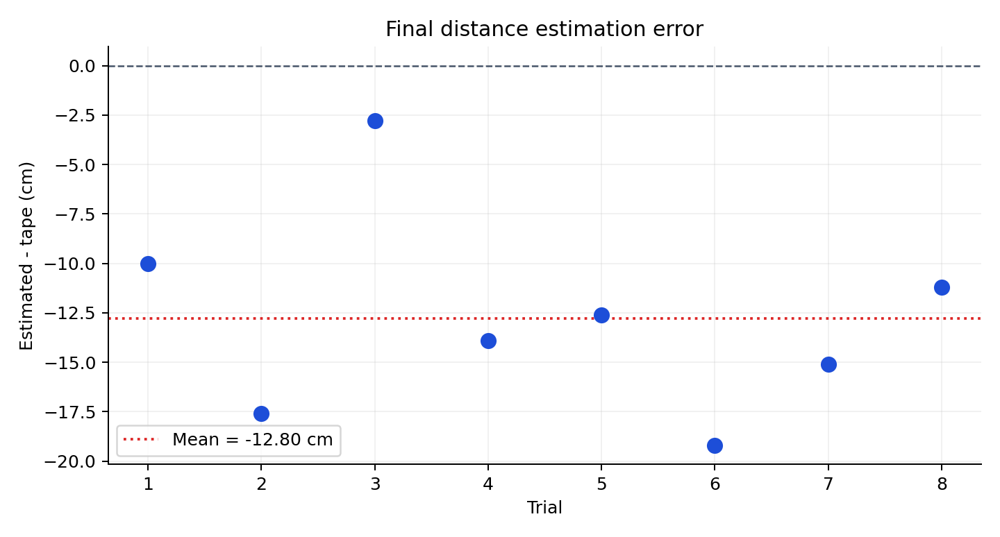
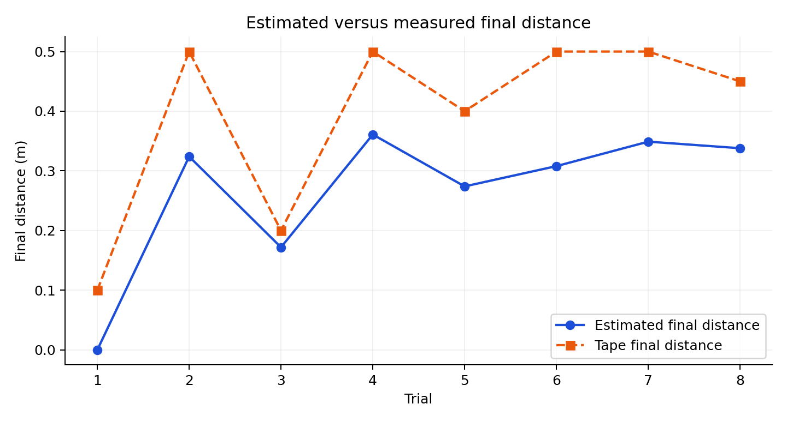
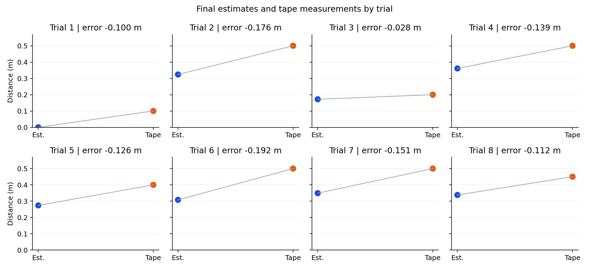
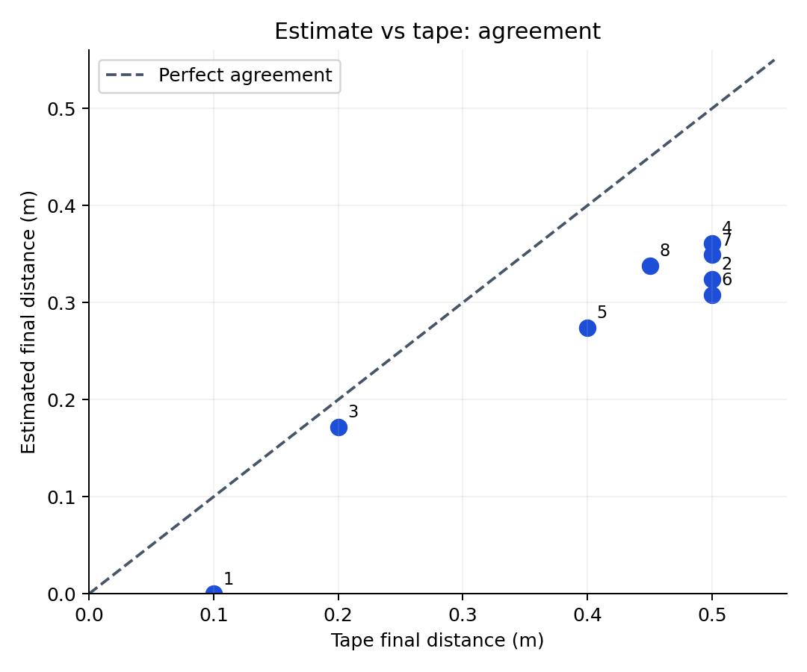

# RoboMaster EP Core - Phase 3 Odometry Prediction and Visual Correction

**Course:** SCE-672 Advanced Robotics, KFUPM  
**Author:** Muhammad Qaisar Ali  
**Platform:** RoboMaster EP Core, Ubuntu, ROS 2 Jazzy

## Objective and scope

Drive straight toward a **fixed QR code**, starting at a physically measured distance between 1 and 2 m. Stop before reaching it. Predict remaining distance from RoboMaster chassis odometry and **correct that distance using the camera's observed QR-code width**. Run 8-10 trials with identical starting conditions; measure the final gap independently with a tape. Calculate signed errors, MAE, range, sample variance, standard deviation, covariance, and scatter plots. Submit the report, GitHub link, and demonstration video.

**No Kalman filter, EKF, SLAM, ToF, or camera pose solver is used.** The camera provides a simple inverse-apparent-width distance measurement. The fixed correction gain is not a Kalman gain.

## Architecture

`robomaster_ros` publishes `/odom` and camera images. `rm_odometry_phase3 experiment` subscribes to both and optionally commands `/cmd_vel`. The experiment node has a QR calibration/alignment phase, a straight drive phase, and a settling phase. `scripts/analyze.py` processes logs after independent tape measurements are entered.

### ROS inputs

- `/odom`: `nav_msgs/msg/Odometry`; uses `pose.pose.position.x`, `.y`, `pose.pose.orientation`, and `twist.twist.linear.x`.
- Camera: `sensor_msgs/msg/CompressedImage` by default, or `sensor_msgs/msg/Image` with `--raw-image`; discover actual topic with `ros2 topic list --no-daemon -t`.
- `/cmd_vel`: `geometry_msgs/msg/Twist`; publishes forward `linear.x` and small yaw corrections `angular.z`.

The RoboMaster `/odom` is already a processed chassis estimate. This project does not claim to know whether onboard firmware performs sensor fusion. The camera width measurement is an external correction to odometry-based distance, not a re-use of `/odom` velocity.

## Equations implemented, why they are used, and where

### 1. Odometry projection along the initial forward direction

 For initial yaw `theta0` and successive odometry positions `(xk,yk)`,

$$
\Delta s_k = (x_k-x_{k-1})\cos\theta_0
           +(y_k-y_{k-1})\sin\theta_0
$$

This extracts signed longitudinal displacement even when the odometry frame is rotated. Implemented in `experiment.py:on_odom`.

### 2. Prediction of remaining distance

$$
\hat d_k^{-}=\hat d_{k-1}^{+}-\Delta s_k
$$

The predicted distance decreases as the robot advances. Implemented in `estimator.py:predict`.

### 3. Camera apparent-width distance A planar QR code of fixed size, viewed approximately front-on, has image width inversely proportional to distance. Calibrate once at the independently measured starting distance `d0` with apparent width `w0` pixels:

$$
c=d_0w_0,\qquad
z_k=d_{\mathrm{camera},k}=\frac{c}{w_k}=d_0\frac{w_0}{w_k}
$$

`w_k` is the average length of the top and bottom detected QR quadrilateral edges. This ratio cancels the unknown focal-length/physical-width product. It assumes constant camera zoom and tag size, roughly frontal viewing, and that the camera and tape measurement use the same distance reference (or a calibrated offset). Camera distance can be biased by perspective, tag tilt, blur, and lens distortion. The inverse-width formula estimates camera-to-tag range; if the tape uses a different robot reference point, a calibrated geometric offset is required before comparing distances. Implemented in `experiment.py:on_image` and `tick`.

### 4. Fixed-gain correction

$$
\begin{aligned}
\varepsilon_k &= z_k-\hat d_k^{-},\\
\hat d_k^{+} &= \hat d_k^{-}+\alpha\varepsilon_k,\\
0&\leq\alpha\leq1.
\end{aligned}
$$

`alpha` is a user-chosen constant (`--gain`, default 0.30). It blends camera distance and odometry prediction; it is **not** calculated from covariance and does **not** implement a Kalman filter. A measurement is accepted only if its innovation magnitude is at most `--max-innovation` (default 0.30 m), to reject obvious outliers. Implemented in `estimator.py:correct` and `experiment.py:tick`.

### 5. Stop condition

$$
\hat d_k^{+}\leq d_{\mathrm{stop}}+d_{\mathrm{margin}}
$$

The controller publishes zero velocity and continues logging for `--settle-time` seconds, to include braking/coasting in the final estimate. Physical stopping error and distance-estimation error are different metrics. Implemented in `experiment.py:tick`.

### 6. Error for each physical trial

$$
\begin{aligned}
e_i &= \hat d_{f,i}-d_{\mathrm{tape},i},\\
\bar e &= \frac{1}{N}\sum_{i=1}^{N}e_i,\\
\mathrm{MAE} &= \frac{1}{N}\sum_{i=1}^{N}|e_i|,\\
\mathrm{RMSE} &= \sqrt{\frac{1}{N}\sum_{i=1}^{N}e_i^2},\\
s_e^2 &= \frac{1}{N-1}\sum_{i=1}^{N}(e_i-\bar e)^2,\\
s_e &= \sqrt{s_e^2},\\
[e_{\min},e_{\max}] &= [\min_i e_i,\max_i e_i].
\end{aligned}
$$

Use **final `DONE` log rows** only. The physical tape measurement must be entered manually; commanded distance is not ground truth. Implemented in `scripts/analyze.py`.

### 7. Cross-trial sample covariance For odometry-only errors `e_o,i` and corrected errors `e_c,i`:

$$
\operatorname{Cov}(e_o,e_c)
=\frac{1}{N-1}\sum_{i=1}^{N}
(e_{o,i}-\bar e_o)(e_{c,i}-\bar e_c).
$$

This is an empirical statistic across completed trials, **not a filter covariance matrix**. The filter itself propagates no covariance.

## Environment and build

Use the existing `~/robomaster_ws/.venv` containing the RoboMaster SDK, and the existing `robomaster_ros` package. Ensure OpenCV and NumPy are importable in the ROS Python interpreter, and Matplotlib/NumPy are available for analysis.

```bash
cd ~/robomaster_ws
source /opt/ros/jazzy/setup.bash
source .venv/bin/activate
source install/setup.bash
export PYTHONPATH="$HOME/robomaster_ws/.venv/lib/python3.12/site-packages:$PYTHONPATH"
colcon build --packages-select rm_odometry_phase3 --symlink-install
source install/setup.bash
```

In **Terminal 1**, start the robot driver with chassis and camera enabled:

```bash
ros2 run robomaster_ros robomaster_driver --ros-args -p conn_type:=sta -p chassis.enabled:=true -p camera.enabled:=true
```

In **Terminal 2**, discover actual camera topics and types:

```bash
ros2 topic list --no-daemon -t
```

## First test - no motion

```bash
ros2 run rm_odometry_phase3 experiment -- --duration 10 --camera-topic /ACTUAL_CAMERA_TOPIC --output ~/robomaster_ws/phase3_data/idle.csv
```

This calibrates the QR width against `--initial-distance` but never commands motion. The initial distance must be measured **from the chosen reference point**. The calibration should be performed at the same orientation and zoom used for the experiment.

## Physical trials (explicit motion opt-in)

For the first official trial, after measuring 1.50 m from the chosen robot reference point to the tag plane:

```bash
ros2 run rm_odometry_phase3 experiment -- \
  --enable-motion \
  --camera-topic /ACTUAL_CAMERA_TOPIC \
  --initial-distance 1.50 \
  --stop-distance 0.40 \
  --safety-margin 0.08 \
  --speed 0.10 \
  --gain 0.30 \
  --output ~/robomaster_ws/phase3_data/trial_01.csv
```

Repeat with filenames `trial_02.csv` through `trial_08.csv` (or through `trial_10.csv` for ten trials). Return the robot to exactly the same starting position each time. If the QR image is tilted or the distance calibration is inaccurate, stop and recalibrate before official trials.

After each trial, wait until the robot has physically stopped and measure the final distance with a tape using **the same reference point** used for calibration. Record it in a copy of `data/measurements_template.csv`, e.g. `~/robomaster_ws/phase3_data/measurements.csv`.

## Generate analysis and figures

```bash
python3 ~/robomaster_ws/src/rm_odometry_phase3/scripts/analyze.py \
  --measurements ~/robomaster_ws/phase3_data/measurements.csv \
  --logs-dir ~/robomaster_ws/phase3_data \
  --output-dir ~/robomaster_ws/phase3_results
```

Generated files include `trial_results.csv`, `statistics.json`, `trial_error_scatter.png`, `trial_error_comparison.png`, and `trial_XX_history.png`. The analysis refuses to invent missing tape measurements and skips incomplete trials.

## Experimental results: eight recorded trials

The following table contains the supplied final distance estimates and independent tape measurements. These are **endpoint measurements**; no intermediate trajectory samples are provided in this dataset. The analysis here describes these eight trials and does not independently verify the underlying field procedure or demonstrate performance of a specific correction gain.

| Trial | Estimated final (m) | Tape final (m) | Signed error (m) |
|---:|---:|---:|---:|
| 1 | 0.000 | 0.100 | -0.100 |
| 2 | 0.324 | 0.500 | -0.176 |
| 3 | 0.172 | 0.200 | -0.028 |
| 4 | 0.361 | 0.500 | -0.139 |
| 5 | 0.274 | 0.400 | -0.126 |
| 6 | 0.308 | 0.500 | -0.192 |
| 7 | 0.349 | 0.500 | -0.151 |
| 8 | 0.338 | 0.450 | -0.112 |

### Error and distance plots









### Statistical analysis

All values below are recomputed directly from [`data/trial_endpoints.csv`](data/trial_endpoints.csv), using the sample denominator $N-1$ for variance and covariance.

| Statistic | Value | Interpretation |
|---|---:|---|
| Number of trials | 8 | Endpoint observations |
| Mean signed error | -0.128000 m | Signed bias |
| MAE | 0.128000 m | Average absolute estimation error |
| RMSE | 0.136549 m | Root-mean-square estimation error |
| Sample variance | 0.002585 m² | Spread of signed errors |
| Sample standard deviation | 0.050841 m | Error dispersion |
| Minimum error | -0.192000 m | Largest underestimation |
| Maximum error | -0.028000 m | Smallest underestimation |
| Error span | 0.164000 m | Maximum minus minimum |
| Sample covariance (estimate, tape) | 0.018570 m² | Co-variation of estimated and tape distances |

The sample covariance between estimated and tape distances is

$$
\operatorname{Cov}(\hat d,d_{\mathrm{tape}})
=\frac{1}{N-1}\sum_{i=1}^{N}
(\hat d_i-\overline{\hat d})(d_{\mathrm{tape},i}-\bar d_{\mathrm{tape}}).
$$

Every signed error is negative, indicating systematic underestimation of final clearance in this dataset. The mean absolute error is 12.8 cm. The eight measured final clearances vary from 0.10 m to 0.50 m. The covariance above is an **empirical cross-trial statistic**, not a Kalman-filter covariance; the implemented correction uses a fixed gain.

To regenerate the plots and statistics after editing the CSV:

```bash
python3 scripts/plot_endpoints.py
```

### Answers to the project assessment questions

| Requested item | Where it is addressed |
|---|---|
| Formulas used and why | **Equations implemented**: odometry projection, range prediction, inverse-width camera measurement, fixed-gain correction, and stop condition. |
| Odometry used | **ROS inputs**: RoboMaster `/odom` position and orientation; projected forward increments provide distance prediction. |
| Scatter plot for every trial | `docs/figures/error_scatter.png` and `docs/figures/individual_trials.png`. |
| Variance and covariance | **Statistical analysis** above; sample variance of errors and sample covariance of estimate versus tape. |
| Video demonstration | Add the URL for the recorded experiment below. |
